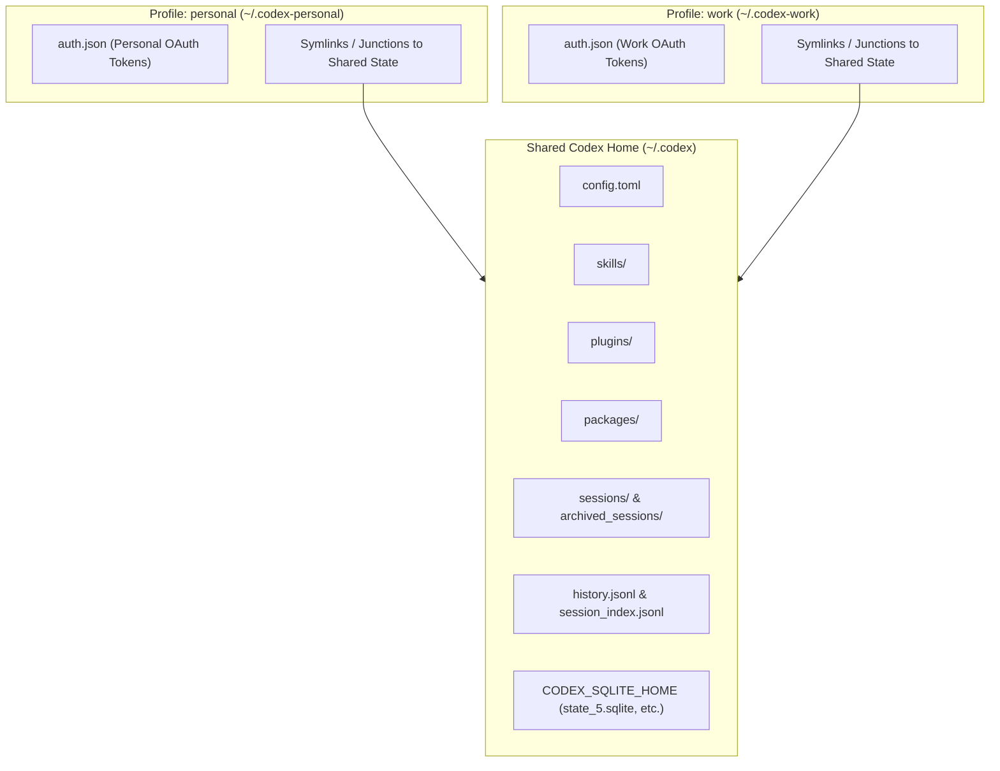

# ⚡ codex-switch

[](https://github.com/Auxes1s/codex-switch/actions/workflows/test.yml)
[](https://github.com/Auxes1s/codex-switch)
[](https://github.com/Auxes1s/codex-switch)
[](https://developers.openai.com/codex/auth)
[](LICENSE)

> **Zero-token-copying profile manager and usage limits dashboard for OpenAI's Codex CLI.** Switch between personal, work, client, and side-gig ChatGPT accounts instantly—with shared session history, zero token revocation risk, and an interactive rate limits dashboard & web homepage.

---

## 📑 Table of Contents

- [Overview & Key Features](#-overview--key-features)
- [Why Authentication Used to Get Revoked](#-why-authentication-used-to-get-revoked)
- [Architecture & State Sharing](#-architecture--state-sharing)
- [Quick Start](#-quick-start)
- [Usage Guide](#-usage-guide)
  - [Profile Switching & Execution](#profile-switching--execution)
  - [Transparent Shell Integration](#transparent-shell-integration)
  - [Live Usage & Rate Limits Dashboard](#live-usage--rate-limits-dashboard)
  - [Interactive Web UI / Homepage](#interactive-web-ui--homepage)
- [Enterprise Safety & Domain Guards](#-enterprise-safety--domain-guards)
- [Post-Failure Auth Diagnostics](#-post-failure-auth-diagnostics)
- [Full Command Reference](#-full-command-reference)
- [Installation](#-installation)
- [Testing](#-testing)
- [License](#-license)

---

## ✨ Overview & Key Features

When juggling multiple ChatGPT accounts (such as a personal subscription, an enterprise company seat, and a client workspace), traditional credential switching tools copy `auth.json` in and out of `~/.codex`. Because Codex uses rolling OAuth refresh tokens, copying files creates competing token caches that inevitably revoke your login sessions.

`codex-switch` provides an isolated, production-grade architecture for multi-account management:

- 🔒 **Zero Token Copying**: Each profile owns its dedicated `CODEX_HOME` (`~/.codex-<profile>/auth.json`). Live refresh tokens are refreshed in-place and never duplicated.
- 🔄 **Unified Sessions & History**: Session transcripts, conversation rollouts, and search indices are seamlessly shared via `~/.codex`, allowing any profile to view and resume sessions created by another.
- 📊 **Real-Time Rate Limits Dashboard**: Inspect 5-hour and weekly window usage percentages, live reset countdowns, and available free reset credits across all accounts in a terminal view with visual progress bars.
- 🌐 **Interactive Web UI (`--web`)**: Launch a modern, dark-mode browser dashboard with auto-refresh and one-click profile switching.
- 🤖 **Smart Profile Recommendation**: Automatically identifies which profile currently has the most available quota so you can switch before hitting rate limits.
- 🛡️ **Enterprise Domain Guards (`--expect-domain`)**: Restricts profiles to specific email domains (e.g. `example.com`), preventing accidental logins into personal accounts on corporate profiles.
- 🧼 **Ambient Credential Scrubbing**: Clears overriding environment variables (`OPENAI_API_KEY`, `CODEX_API_KEY`, `CODEX_ACCESS_TOKEN`, workload-identity variables) so launches always honor the selected profile.
- 🩺 **Non-Leaking Self Diagnostics**: Interrogates Codex's app-server RPC upon unexpected launch errors to pinpoint expired or revoked sessions without exposing credentials or tokens in logs.
- 🪟 **First-Class Cross-Platform**: Fully supported on macOS, Linux (POSIX shell), and Windows (PowerShell 5.1, PowerShell 7+, and CMD).

---

## 🔍 Why Authentication Used to Get Revoked

In legacy workflows, switching profiles involved copying `auth.json` into and out of `~/.codex`. ChatGPT login uses automatically refreshed credentials as documented in the [official Codex authentication docs](https://developers.openai.com/codex/auth).

Every copy becomes a competing refresh-token cache:
1. If a background Codex process, IDE extension, or terminal session refreshes a token in `~/.codex`, the refreshed token is stored only in that location.
2. The inactive profile retained a stale copy of the older token.
3. Upon switching back, presenting the stale token invalidates the entire OAuth refresh chain, forcing an unnecessary browser re-authentication.

`codex-switch` solves this fundamentally:
```text
~/.codex-personal/auth.json   <-- Dedicated refresh-token cache
~/.codex-work/auth.json       <-- Dedicated refresh-token cache
~/.codex-gig/auth.json        <-- Dedicated refresh-token cache
```

Codex is launched with `CODEX_HOME=~/.codex-<profile>` and explicitly forced to `cli_auth_credentials_store="file"`. Tokens are **never copied**. Codex refreshes only the single file belonging to the active profile.

---

## 🏗️ Architecture & State Sharing

While credentials remain strictly isolated, your configuration, plugins, skills, session history, and runtime databases are shared from `~/.codex`:



### Shared Resources Breakdown

| Resource | Scope | Purpose |
| :--- | :--- | :--- |
| `auth.json` | **Isolated** per profile | Keeps OAuth tokens separate; prevents competing refresh-token caches. |
| `config.toml` | **Shared** (`~/.codex`) | Synchronizes model configurations, preferences, and flags across profiles. |
| `skills/`, `plugins/`, `packages/` | **Shared** (`~/.codex`) | Installed extensions and custom skills are instantly available everywhere. |
| `sessions/`, `archived_sessions/` | **Shared** (`~/.codex`) | Session transcripts and rollouts can be resumed from any profile. |
| `history.jsonl`, `session_index.jsonl` | **Shared** (`~/.codex`) | Unified prompt and session search index. |
| SQLite Databases (`state_5.sqlite`, etc.) | **Shared** via `CODEX_SQLITE_HOME` | Centralized titles, projects, goals, message board, and task queues. |

### Automatic Database Migration

When shared session state is first enabled, existing profile session files and SQLite databases (`state_5.sqlite`, `thread_history_1.sqlite`, `goals_1.sqlite`, `queue_1.sqlite`, `memories_1.sqlite`, `logs_2.sqlite`, `agent_message_board_1.sqlite`) are merged into `~/.codex`.

- For duplicate primary keys, records with the newer timestamp are preferred.
- Conflicting updates halt migration safely for manual review.
- Pre-migration snapshots and original files are preserved under `~/.codex/.codex-switch-legacy-state/`.
- Requires Python 3 once for migration; normal day-to-day launches do not require Python.

---

## 🚀 Quick Start

### 1. Install `codex-switch`

**macOS / Linux:**
```sh
./install.sh
```
*(Installs to `~/.local/bin/codex-switch` by default)*

**Windows (PowerShell):**
```powershell
.\install.ps1
```
*(Installs to `%LOCALAPPDATA%\Programs\codex-switch\bin` and updates user `PATH`)*

### 2. Set Up Your Profiles

Authenticate each ChatGPT account once:
```sh
codex-switch login personal
codex-switch login work
codex-switch login client
```

For remote or headless machines, pass the `--device-auth` flag:
```sh
codex-switch login work --device-auth
```

### 3. Switch and Run

```sh
# Select the active profile
codex-switch work

# Run Codex directly through the active profile
codex-switch run -- exec "summarize project architecture"
```

---

## 💻 Usage Guide

### Profile Switching & Execution

Switch active profiles with a single argument:
```sh
codex-switch personal
codex-switch work
```

Run one-off commands under a specific profile without changing the active marker:
```sh
codex-switch run personal exec "review pull request #42"
```

Inspect active selection and profile status:
```sh
codex-switch current       # Prints current active profile
codex-switch list          # Lists all profiles with active/signed-out badges
codex-switch status        # Verifies login status of the active profile
codex-switch status work   # Verifies login status of a specific profile
```

### Transparent Shell Integration

For the most fluid workflow, add shell integration so ordinary `codex` commands automatically route through your active profile.

**Zsh (`~/.zshrc`) / Bash (`~/.bashrc`):**
```sh
eval "$(codex-switch shell-init)"
```

**Fish (`~/.config/fish/config.fish`):**
```fish
codex-switch shell-init | source
```

**PowerShell (`$PROFILE`):**
```powershell
Invoke-Expression (codex-switch.ps1 shell-init | Out-String)
```

Now use standard `codex` commands directly:
```sh
codex-switch personal
codex                      # Launches Codex under 'personal'

codex-switch work
codex exec "run tests"     # Runs under 'work'
```

> [!NOTE]
> Shell integration only routes commands in your terminal shell. The desktop app and IDE extension continue using their own standard login in `~/.codex`.

---

### 📊 Live Usage & Rate Limits Dashboard

`codex-switch dashboard` (or `codex-switch home`) connects to Codex's app-server RPC to pull live rate limits, usage metrics, reset countdowns, and reset credits across all configured profiles:

```sh
codex-switch dashboard
```

#### Terminal Dashboard Preview:

```text
================================================================================
  ⚡ CODEX-SWITCH DASHBOARD • REMAINING QUOTA & LIMITS STATUS
================================================================================
  Active Profile : work
  Readiness      : 2 ready • 1 low quota • 0 exhausted • 0 signed out
  Recommended    : Switch to client-corp (highest remaining quota)
--------------------------------------------------------------------------------

● work  (ACTIVE)  [READY]
  Account     : dev@acmecorp.com (ChatGPT Team)
  5-Hour Limit: [██████████████]  82% left (18% used) • Resets in 3h 14m (14:32)
  Weekly Limit: [██████████░░░░]  68% left (32% used) • Resets in 4d 18h

○ personal  [READY]
  Account     : me@gmail.com (ChatGPT Plus)
  5-Hour Limit: [██████████████]  95% left (5% used) • Resets in 4h 45m (16:03)
  Weekly Limit: [██████████████]  91% left (9% used) • Resets in 6d 2h
  Credits     : ✨ 1 free rate limit reset(s) available

○ client-corp  [READY]
  Account     : contractor@client.org (ChatGPT Enterprise)
  5-Hour Limit: [██████████████] 100% left (0% used) • Ready now
  Weekly Limit: [██████████████]  98% left (2% used) • Resets in 6d 22h

--------------------------------------------------------------------------------
  Quick Actions :
    Switch profile : codex-switch <profile>
    Web dashboard  : codex-switch dashboard --web
    Live watch     : codex-switch dashboard --watch
================================================================================
```

#### Dashboard Options:

- **Live Watch Mode**: Auto-refreshes terminal metrics every 5 seconds:
  ```sh
  codex-switch dashboard --watch
  ```
- **Inspect Specific Profile**:
  ```sh
  codex-switch dashboard work
  ```
- **JSON Output**: Machine-readable status report for custom status bar integrations (tmux, Waybar, Starship):
  ```sh
  codex-switch dashboard --json
  ```
- **Shortcut from Status**:
  ```sh
  codex-switch status --dashboard
  ```

---

### 🌐 Interactive Web UI / Homepage

Launch a browser-based homepage with live auto-refresh and one-click profile switching:

```sh
codex-switch dashboard --web
```
*(Aliases: `codex-switch dashboard -w` or `codex-switch home --web`)*

- **Modern Dark UI**: Clean, responsive layout designed for high visibility.
- **One-Click Profile Switching**: Click "Switch to work" to immediately select a profile without touching the terminal.
- **Auto-Refresh**: Live 30-second polling keeps rate limits and reset timers current.
- **Visual Status Badges**: Instant color-coded indicators for `READY`, `HIGH USAGE`, `RATE LIMITED`, and `SIGNED OUT`.
- **Local & Private**: Runs on `http://127.0.0.1:8420` using Python's standard library; no external services or telemetry.

---

## 🛡️ Enterprise Safety & Domain Guards

### Corporate Domain Locking

To prevent accidentally logging into a personal account when configuring a corporate seat, lock the profile to an expected email domain:

```sh
# Windows PowerShell
codex-switch login work --expect-domain mycompany.com
```

The domain guard is validated on every `switch`, `run`, and `status`. If the profile's token claims point to a different email domain, the operation stops immediately.

### Atomic Staged Logins (Windows)

On Windows, `login` authenticates inside an isolated temporary staging home protected with strict NTFS ACLs (inheritance removed, owner full control). Staged credentials are validated against the expected domain and published atomically to the profile home only after authentication succeeds. If login fails or is cancelled, existing credentials remain untouched.

### Ambient Variable Scrubbing

When launching Codex, `codex-switch` unsets ambient authentication variables:
- `OPENAI_API_KEY`
- `CODEX_API_KEY`
- `CODEX_ACCESS_TOKEN`
- `OPENAI_IDENTITY_TOKEN_FILE`
- `OPENAI_FEDERATION_RULE_ID`

This guarantees that an API key set in your terminal environment cannot unintentionally override your profile's ChatGPT credentials.

---

## 🩺 Post-Failure Auth Diagnostics

If Codex exits with a failure code, `codex-switch` launches a 6-second non-blocking diagnostic query to Codex's app-server RPC:

- **Pinpoints Revocations**: Distinguishes between network errors, configuration issues, and revoked OAuth refresh tokens.
- **Remediation Commands**: Tells you exactly which profile needs re-authentication:
  ```text
  codex-switch: Codex authentication failed for profile 'work'.
  codex-switch: Codex reports: Your session has ended. Please log in again. (refresh_token_invalidated)
  codex-switch: Sign in again: codex-switch login work
  ```
- **Zero Token Leakage**: Inspects structured error codes and plain-prose messages; raw tokens and full JSON payloads are never echoed to terminal output or logs.
- Does not run on successful launches or exit statuses unrelated to auth.

---

## 📖 Full Command Reference

| Command | Description |
| :--- | :--- |
| `codex-switch <profile>` | Selects `<profile>` as the active Codex profile. |
| `codex-switch switch <profile>` | Explicit alias to select `<profile>`. |
| `codex-switch run [<profile>] [--] [args...]` | Runs Codex under `<profile>` (or active profile if omitted). |
| `codex-switch login <profile> [args...]` | Authenticates `<profile>` via browser login flow. Automatically creates profile if missing. |
| `codex-switch auth <profile> [args...]` | Alias for `login`. |
| `codex-switch logout <profile>` | Signs out `<profile>` by invoking Codex logout. |
| `codex-switch dashboard [flags] [<profile>]` | Displays rate limits, 5h & weekly window usage, and profile recommendations. |
| `codex-switch home [flags] [<profile>]` | Alias for `dashboard`. |
| `codex-switch status [<profile>]` | Verifies login status using `codex login status`. |
| `codex-switch status --dashboard` | Launches the rate limits dashboard from `status`. |
| `codex-switch list` | Lists all configured profiles with status badges (`active`, `signed out`). |
| `codex-switch current` | Prints the active profile name. |
| `codex-switch add <profile>` | Creates a profile directory and shared links without copying credentials. |
| `codex-switch remove <profile>` | Safely deletes managed profile links and credentials (refuses active profile). |
| `codex-switch shell-init` | Emits shell wrapper code for transparent `codex` execution. |
| `codex-switch --help` | Displays usage summary. |

### Environment Variables

| Variable | Description |
| :--- | :--- |
| `CODEX_SWITCH_INSTALL_DIR` | Custom installation directory for `install.sh` or `install.ps1`. |
| `CODEX_SWITCH_CODEX_BIN` | Custom Codex binary path (defaults to `codex` on `PATH`). |
| `CODEX_SWITCH_PYTHON` | Python 3 executable path used for migration, diagnostics, and dashboard. |
| `CODEX_SWITCH_DISABLE_HOOKS` | Set to `1` on Windows to suppress console hook windows (`run --with-hooks` overrides). |

---

## 📦 Installation

### Linux / macOS

Run the install script from the repository:
```sh
git clone https://github.com/Auxes1s/codex-switch.git
cd codex-switch
./install.sh
```

By default, binaries are placed in `~/.local/bin`. Ensure `~/.local/bin` is in your `PATH`:
```sh
export PATH="$HOME/.local/bin:$PATH"
```

To install to a custom directory (e.g. `/usr/local/bin`):
```sh
CODEX_SWITCH_INSTALL_DIR=/usr/local/bin ./install.sh
```

### Windows

Open PowerShell and run:
```powershell
git clone https://github.com/Auxes1s/codex-switch.git
cd codex-switch
.\install.ps1
```

The installer copies launcher scripts to `%LOCALAPPDATA%\Programs\codex-switch\bin` and automatically appends it to your user `PATH`. Restart your terminal after installing.

---

## 🧪 Testing

Comprehensive test suites cover POSIX shell scripts, PowerShell scripts, SQLite migration safety, and rate limits formatting:

### POSIX Test Suite (macOS / Linux):
```sh
./tests/codex-switch.test.sh
python3 ./tests/migration.test.py
python3 ./tests/diagnostics.test.py
python3 ./tests/dashboard.test.py
```

### Windows Test Suite:
```powershell
.\tests\codex-switch.test.ps1
python .\tests\migration.test.py
python .\tests\dashboard.test.py
```

---

## 📄 License

This project is open-source software licensed under the [MIT License](LICENSE).
